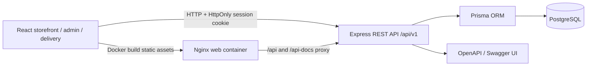
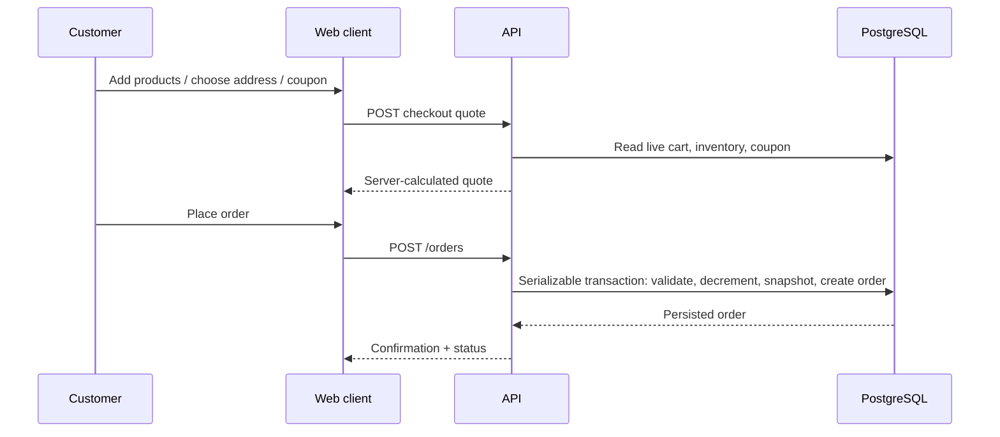
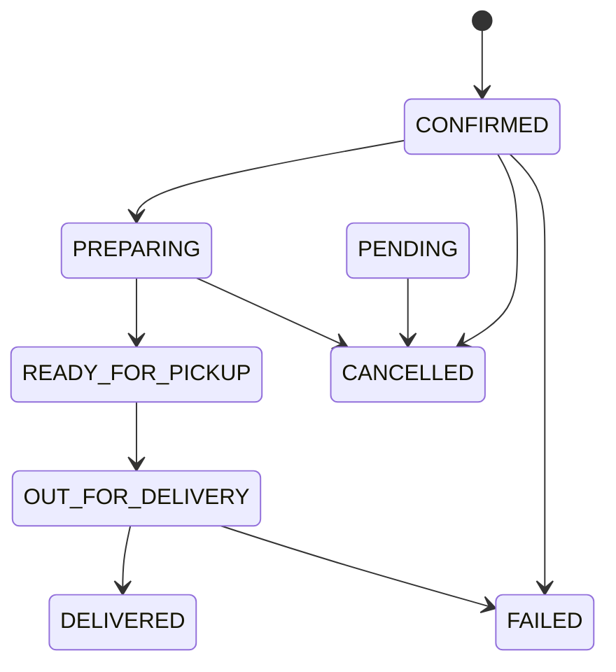

# Architecture

QUICKORA is a modular monolith with a separate React client and Express API. PostgreSQL persists identity, catalog, inventory, carts, coupons, orders and delivery assignments; Prisma provides typed database access.

The browser maintains a persisted guest basket for convenience. The API revalidates product activity, current stock, coupons and prices at checkout. A serializable transaction atomically decrements stock, writes immutable order item/address snapshots, records coupon redemption and clears the account basket. Role middleware and resource ownership checks protect private routes.

Order lifecycle:

The customer application polls persisted status every 15 seconds. Delivery dispatch and ETA are demo operations, not live GPS tracking.
