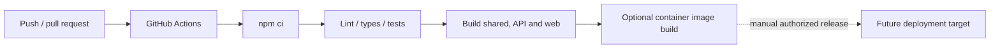

# Deployment

The recommended local deployment is `docker compose up --build`. PostgreSQL has a health check and persistent named volume; the API waits for database readiness, migrates and seeds; Nginx serves the production Vite bundle and proxies API requests. Health/readiness routes are `/health` and `/ready`.

For production, build and publish the API and web images through CI, provision managed PostgreSQL, inject secrets at runtime, set a public trusted web origin and HTTPS secure cookies, apply migrations as a controlled release step and disable demo credentials/seeding. No cloud resources are created by this project.

Compose service logs are available with `docker compose logs -f <service>`. The web container exposes port 5173; API 4000; database 5432.
